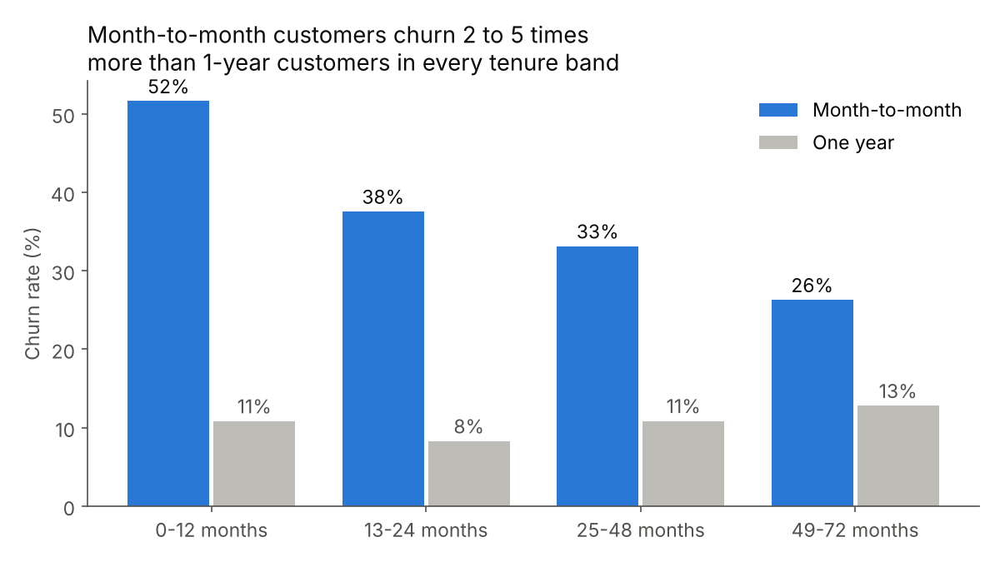
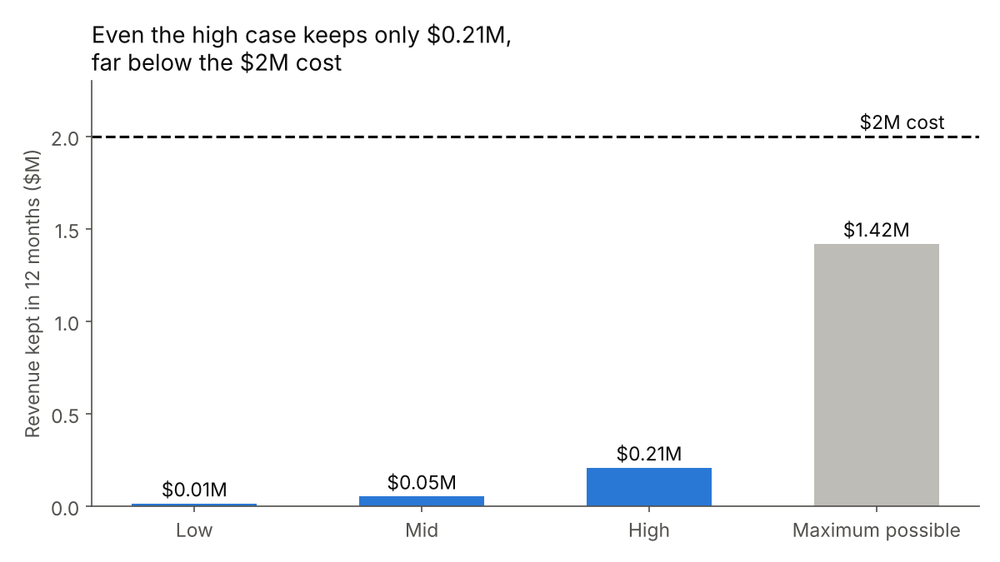
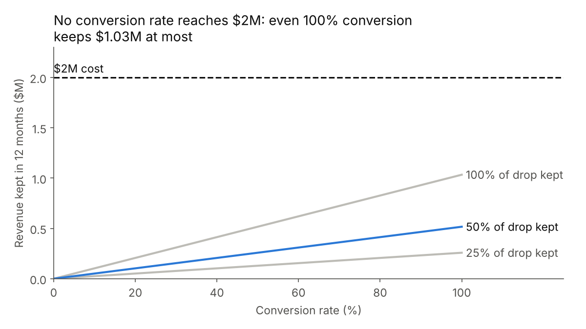

# Recommendation: $2M campaign to move month-to-month customers to 1-year contracts

Brief: `briefs/2m-campaign.md`. Every number comes from `runs/telco/analysis.py`.
Labels: **data** = counted from the file. **derived** = calculated from data numbers. **assumption** = not in the data.

## 1. Summary

**Recommendation: do not fund** (based on this data file).

**What we found**
- Month-to-month customers churn 42.8% (**data**: 1,616 of 3,773). One-year customers churn 11.3% (**data**: 161 of 1,420).
- The gap holds in every tenure band. Month-to-month churn is 2 to 5 times higher (**derived**).
- Month-to-month contracts are *associated with* higher churn. The data does not show that a contract change causes lower churn.
- The campaign keeps $12,925 (low), $51,700 (mid), or $206,799 (high) of revenue in 12 months (**derived**). All three cases are below the $2M cost.
- No conversion rate can reach $2M. At 100% conversion with the full churn drop kept, the campaign keeps $1,033,996 (**derived**).
- Even if every month-to-month churner stayed 12 more months, the revenue kept is $1,417,774 (**derived**). That is still below $2M.

**Value range (12 months, against $2M cost)**

| Case | Conversion (**assumption**) | Share of churn drop kept (**assumption**) | Revenue kept (**derived**) |
|---|---|---|---|
| Low | 5% | 25% | $12,925 |
| Mid | 10% | 50% | $51,700 |
| High | 20% | 100% | $206,799 |

**How sure we are:** sure for this file. The result is far from the threshold, and no assumption in the brief can change it. We are **not** sure for the real business, because the full customer base size is **unknown** (see risk 1).

**Data issues:** 422 rows removed (211 repeated IDs with opposite churn values). 200 rows have charges about 100 times too high, so we left them out of revenue numbers. 11 blank `TotalCharges` were set to 0. We did not use `RetentionOfferAccepted` because it reveals the answer. The result does not change if we keep the repeated IDs.

**Risks**
1. **Base size is unknown.** If this file is a sample, scale the results. The mid case reaches $2M only with about 145,958 month-to-month customers (38.7 times this file). The high case needs about 36,490 (9.7 times) (**derived**).
2. Churn is defined as "left in the last month". We treat it as the share that leaves within 12 months (**assumption**). If the real 12-month churn is higher, the value is higher.
3. One-year customers chose their own contracts. They may be more loyal by nature, so the churn drop is a maximum.

**Next step:** ask Finance for the number of month-to-month customers in the full base. If it is above about 36,490, run the analysis again at that scale before you decide.

## 2. Charts



In every tenure band, month-to-month customers churn more than 1-year customers, from 26.3% vs 12.8% (49–72 months) to 51.6% vs 10.8% (0–12 months).



All three cases keep less than $0.21M, and even the maximum possible ($1.42M) is below the $2M cost.



Revenue kept rises with the conversion rate, but no line reaches $2M before 100% conversion, so no break-even point exists.

## 3. Appendix

### 3.1 Data source and size
- File: `data/raw/telco_v2.csv` (not changed).
- Rows: 7,254 (**data**). Unique `customerID`: 7,043 (**data**). Columns: 23.
- After cleaning: 6,832 customers (**data**). Churn rate: 26.7% (**derived**: 1,822 / 6,832).

### 3.2 Data dictionary

| Column | Meaning | Type |
|---|---|---|
| customerID | Customer ID | text |
| gender | Female or Male | text |
| SeniorCitizen | 1 = senior citizen, 0 = not | number (0/1) |
| Partner | Has a partner (Yes/No) | text |
| Dependents | Has dependents (Yes/No) | text |
| tenure | Months as a customer (0–72) | number |
| PhoneService | Has phone service (Yes/No) | text |
| MultipleLines | Has more than one line (Yes/No/No phone service) | text |
| InternetService | Internet type (DSL/Fiber optic/No) | text |
| OnlineSecurity, OnlineBackup, DeviceProtection, TechSupport, StreamingTV, StreamingMovies | Has this add-on (Yes/No/No internet service) | text |
| Contract | Contract type (Month-to-month/One year/Two year) | text |
| PaperlessBilling | Gets paperless bills (Yes/No) | text |
| PaymentMethod | How the customer pays (4 values) | text |
| MonthlyCharges | Monthly charge in $ (18.25–118.75 normal; 200 rows up to 11,515) | number |
| TotalCharges | Total charged in $ (stored as text in the raw file) | number |
| Churn | Left in the last month (Yes/No) | text |
| LoyaltyAppUser | Uses the loyalty app (Yes/No) | text |
| RetentionOfferAccepted | Accepted a retention offer (filled only for churned customers) | text |

### 3.3 Cleaning summary
Full list of rows: `cleaning_log.md`.

| Step | Rows | Action |
|---|---|---|
| Start | 7,254 | – |
| Repeated `customerID` with opposite `Churn` | −422 | Removed both rows of each of 211 pairs |
| `MonthlyCharges` > 200 | 200 (kept) | Flagged `charge_outlier`; left out of revenue averages |
| `TotalCharges` blank (tenure = 0) | 11 (changed) | Set to 0; converted the column to a number |
| `RetentionOfferAccepted` | 5,221 blank (kept) | Not used as a driver |
| End | 6,832 | – |

### 3.4 Key result tables

**Churn by contract (data)**

| Contract | Customers | Churned | Churn rate |
|---|---|---|---|
| Month-to-month | 3,773 | 1,616 | 42.8% |
| One year | 1,420 | 161 | 11.3% |
| Two year | 1,639 | 45 | 2.7% |

**Churn by tenure band and contract (data)**

| Tenure (months) | Month-to-month customers | Month-to-month churn | One-year customers | One-year churn |
|---|---|---|---|---|
| 0–12 | 1,934 | 51.6% | 120 | 10.8% |
| 13–24 | 722 | 37.5% | 193 | 8.3% |
| 25–48 | 782 | 33.1% | 497 | 10.9% |
| 49–72 | 335 | 26.3% | 610 | 12.8% |

**Month-to-month segments.** If a segment has fewer than 100 one-year customers, the tenure-band one-year rate is used instead.

| Tenure | Internet | M2M customers | M2M churn | 1-year rate used (source) | Churn drop | Revenue per customer, 12 months | Value at 100% conversion |
|---|---|---|---|---|---|---|---|
| 0–12 | DSL | 670 | 42.7% | 10.8% (band) | 31.9 pp | $572.6 | $122,213 |
| 0–12 | Fiber optic | 892 | 70.2% | 10.8% (band) | 59.3 pp | $983.8 | $520,765 |
| 0–12 | No | 372 | 23.1% | 10.8% (band) | 12.3 pp | $243.3 | $11,120 |
| 13–24 | DSL | 228 | 22.8% | 8.3% (band) | 14.5 pp | $630.8 | $20,880 |
| 13–24 | Fiber optic | 415 | 50.8% | 8.3% (band) | 42.6 pp | $1,050.1 | $185,450 |
| 13–24 | No | 79 | 10.1% | 8.3% (band) | 1.8 pp | $248.5 | $361 |
| 25–48 | DSL | 223 | 16.1% | 9.3% (segment) | 6.9 pp | $642.7 | $9,879 |
| 25–48 | Fiber optic | 507 | 43.6% | 20.8% (segment) | 22.8 pp | $1,095.8 | $126,583 |
| 25–48 | No | 52 | 3.8% | 1.7% (segment) | 2.2 pp | $253.5 | $289 |
| 49–72 | DSL | 70 | 12.9% | 6.5% (segment) | 6.4 pp | $641.2 | $2,868 |
| 49–72 | Fiber optic | 263 | 29.7% | 18.5% (segment) | 11.1 pp | $1,141.6 | $33,413 |
| 49–72 | No | 2 | 50.0% | 12.8% (band) | 37.2 pp | $236.4 | $176 |
| **Total** | | **3,773** | | | | | **$1,033,996** |

**Formulas (derived)**
- Churn drop = M2M churn rate − 1-year rate used (0 if negative)
- Value at 100% conversion = M2M customers × churn drop × revenue per customer
- Revenue per customer = mean `MonthlyCharges` of M2M customers in the segment, without outliers, × 12
- Revenue kept = total value at 100% conversion × conversion rate × share of drop kept
- Break-even conversion = $2M ÷ (total value at 100% conversion × share of drop kept): 774% (low), 387% (mid), 193% (high). All are above 100%, so break-even is not possible.
- Maximum possible = Σ M2M churners × revenue per customer = $1,417,774

**Check with the repeated IDs kept (first row of each pair):** low $12,675, mid $50,702, high $202,808. Recommendation: do_not_fund (no change).

**Drivers.** Gap = churn rate of the focus group minus the rest, in percentage points (**derived**). "none" means a gap under 2 points.

| Variable | Focus group | Gap overall | Gap M2M | Gap 1-year | Gap 2-year | Overall | Within contract |
|---|---|---|---|---|---|---|---|
| Contract | Month-to-month | +36.1 | – | – | – | higher | not_checked |
| tenure | ≤ 12 months | +30.5 | +18.0 | −0.6 | −2.9 | higher | mixed |
| PaymentMethod | Electronic check | +28.3 | +21.2 | +9.3 | +5.1 | higher | higher |
| InternetService | Fiber optic | +27.5 | +26.4 | +12.5 | +5.7 | higher | higher |
| SeniorCitizen | = 1 | +18.2 | +15.1 | +4.9 | +1.6 | higher | higher |
| PaperlessBilling | Yes | +17.1 | +16.4 | +7.6 | +2.5 | higher | higher |
| MonthlyCharges | > median (71.65) | +15.8 | +19.5 | +11.0 | +3.3 | higher | higher |
| LoyaltyAppUser | Yes | +9.6 | −22.9 | −5.4 | −2.0 | higher | lower |
| StreamingTV | Yes | +5.7 | +11.9 | +13.0 | +3.5 | higher | higher |
| StreamingMovies | Yes | +5.6 | +11.5 | +15.0 | +3.1 | higher | higher |
| MultipleLines | Yes | +3.3 | +9.1 | +6.7 | +2.2 | higher | higher |
| PhoneService | Yes | +1.9 | +2.4 | +2.3 | +0.9 | none | higher |
| gender | Female | +1.0 | +2.4 | −1.5 | −0.3 | none | mixed |
| DeviceProtection | Yes | −6.3 | +0.7 | +5.7 | +2.7 | lower | higher |
| OnlineBackup | Yes | −7.7 | −6.7 | +6.1 | +1.1 | lower | mixed |
| Partner | Yes | −13.5 | −6.1 | +1.8 | −0.7 | lower | mixed |
| Dependents | Yes | −15.6 | −12.1 | −2.7 | −0.9 | lower | lower |
| TotalCharges | > median (1,391.4) | −15.6 | −10.6 | +8.7 | +2.7 | lower | mixed |
| TechSupport | Yes | −16.1 | −14.7 | +4.1 | +1.3 | lower | mixed |
| OnlineSecurity | Yes | −16.8 | −16.3 | −0.7 | +0.3 | lower | mixed |

Note: `LoyaltyAppUser` reverses. App users churn more overall, but less within every contract type. 85.8% of app users are on month-to-month contracts, compared with 28.9% of non-users (**data**). So contract mix hides the pattern within each contract.

### 3.5 Assumptions

| Assumption | Low | Mid | High | Set by | Why |
|---|---|---|---|---|---|
| Conversion rate | 5% | 10% | 20% | Analyst, not tested | No past campaign data |
| Share of churn drop kept after a switch | 25% | 50% | 100% | Brief owner | Self-selection: 1-year customers may be loyal by nature |
| Monthly charge after a switch | Same | Same | Same | Brief owner | No price change planned |
| Months of revenue kept | 12 | 12 | 12 | Brief owner | Decision window |
| Churn rate = share that leaves within 12 months | Same | Same | Same | Analyst | Data has only "left in the last month" |
| Target group = all M2M customers in this file (3,773) | Same | Same | Same | Brief owner | Full base size is unknown |
| Tenure bands 0–12, 13–24, 25–48, 49–72 | Same | Same | Same | Brief owner | First and second contract year |
| Use the band 1-year rate if a segment has < 100 one-year customers | Same | Same | Same | Analyst | 8 of 12 segments are too small (Fiber 0–12 has 7) |
| `MonthlyCharges` > 200 is an error | Same | Same | Same | Analyst | Normal values stop at 118.75 |
| Driver "none" if gap < 2 points | Same | Same | Same | Analyst | Small gaps are noise at this size |

### 3.6 Run again
From the repo root:

```bash
pip install pandas matplotlib tabulate
python3 runs/telco/analysis.py
```

All tables are also in `results.md` and `results.json`.
